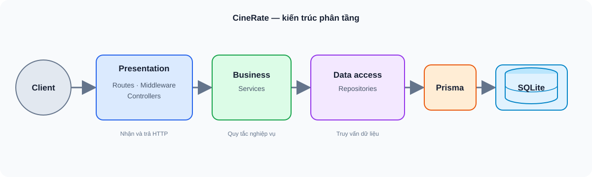

# CineRate API — Tài liệu bàn giao Phase 1

CineRate là REST API cho nền tảng đánh giá phim cộng đồng. Phase 1 xây dựng các nghiệp vụ nền tảng, ghi nhận baseline hiệu năng và chuẩn bị cấu trúc để nhóm Phase 2 tiếp tục cải tiến. README này tóm tắt dự án; chi tiết kiến trúc và benchmark nằm trong [docs/architecture.md](./docs/architecture.md).

## Bài toán và nghiệp vụ

Người dùng có thể đăng ký, đăng nhập và quản lý hồ sơ; tra cứu phim và thể loại; chấm điểm phim từ 1 đến 10; viết nhận xét; lưu phim vào watchlist cá nhân. Mỗi người dùng có một rating và một mục watchlist cho mỗi phim. Người dùng có thể cập nhật rating, còn review chỉ được xóa bởi tác giả. Người dùng đã đăng nhập có thể thêm hoặc xóa phim.

## Kiến trúc và tổ chức mã nguồn

Ứng dụng dùng kiến trúc ba tầng và dependency injection thủ công tại [src/container.js](./src/container.js). Routes, controllers và middleware tiếp nhận HTTP; services xử lý nghiệp vụ; repositories truy cập SQLite qua Prisma.

- `src/` — routes, controllers, services, repositories, middleware và cấu hình Express.
- `prisma/` — schema bảy bảng, migrations và dữ liệu mẫu.
- `tests/` — unit tests, integration tests và script đo tải.
- `docs/` — tài liệu kiến trúc, sơ đồ và đặc tả OpenAPI.

## Công nghệ

Node.js 20.19+, Express 4, Prisma 6, SQLite, JWT, bcryptjs và Docker Compose. Jest dùng cho unit/integration tests; Autocannon dùng cho đo tải.

## Chạy dự án

Cần Node.js 20.19+ và npm, hoặc Docker Compose. Khi chạy local:

~~~bash
npm ci
cp .env.example .env
# Đặt JWT_SECRET thành giá trị riêng, đủ ngẫu nhiên
npm run db:generate
npm run db:migrate
npm run db:seed
npm run dev
~~~

API chạy tại `http://localhost:3000`. Giao diện Swagger UI tại `http://localhost:3000/api-docs/`. Với Docker Compose, đặt `JWT_SECRET` trong `.env` rồi chạy:

~~~bash
docker compose up --build -d
~~~

SQLite được lưu trong named volume `sqlite-data` để tồn tại qua lần dừng hoặc thay container. Lệnh `docker compose down` giữ volume.

## API và baseline Phase 1

Đặc tả 18 API endpoint cùng health check nằm tại [docs/swagger.yaml](./docs/swagger.yaml), định dạng OpenAPI 3.0.3. Có thể preview bằng Swagger UI sau khi khởi động ứng dụng.

Benchmark trên Kaggle CPU (4 vCPU, 10 kết nối đồng thời, 10 giây mỗi endpoint) ghi nhận 99.478 request trong 193 giây, khoảng 515 request/giây gộp. GET đạt khoảng 526–2.094 RPS; các thao tác ghi đạt 10–76 RPS. Ba request timeout xuất hiện dưới tải ghi đồng thời. Auth có độ trễ cao nhất; bcrypt là một yếu tố cần profiling thêm, còn benchmark này chưa đủ để kết luận Event Loop bị chặn.

Các điểm cần nhóm Phase 2 xem xét: SQLite chỉ cho phép một writer tại một thời điểm; dự án cũng chưa có cache hay tầng validation schema riêng.

