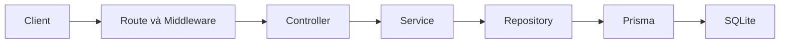

# CineRate Backend Pha 1

Backend REST API quản lý phim, tài khoản, điểm đánh giá, nhận xét và danh sách xem sau. Dùng Node.js, Express, Prisma, SQLite và JWT; giao tiếp JSON.

## Kiến trúc



- [Routes](./src/routes) khai báo HTTP method, URL và dùng lại `authenticate` của A.
- [Controllers](./src/controllers) đọc request, gọi service và trả HTTP/JSON qua `catchAsync`.
- [Services](./src/services) kiểm tra nghiệp vụ bằng JavaScript thuần; không import Express hay Prisma.
- [Repositories](./src/repositories) nhận Prisma Client qua constructor và thực hiện truy vấn.
- [Container](./src/container.js) tạo một Prisma Client, nối repository → service → controller qua constructor.
- [App](./src/app.js) gắn các router trước 404 handler và error middleware. Router Rating/Review được gắn ở `/api`, có đường dẫn đầy đủ tương ứng, không sửa router Movie của B.

[Schema](./prisma/schema.prisma) hiện có **7 bảng**: users, movies, genres, movie_genres, ratings, reviews, watchlist. C không thay schema hoặc migration. Unique `(userId, movieId)` bảo đảm mỗi user chỉ có một rating và một mục watchlist cho mỗi phim. Các quan hệ có cascade delete.

## Chạy trên máy cá nhân

Yêu cầu Node.js 20 trở lên và npm. Sau khi clone repo:

```powershell
npm ci
Copy-Item .env.example .env
npm run db:generate
npm run db:migrate
npm run db:seed
npm run dev
```

Chỉ copy file môi trường khi chưa có `.env`. Trước khi chạy server, đặt `JWT_SECRET` riêng đủ mạnh trong `.env`; không dùng giá trị mẫu cho production. `DATABASE_URL=file:./dev.db` được tính theo thư mục schema Prisma, tương ứng `prisma/dev.db`.

- API mặc định: `http://localhost:3000`.
- Health: `http://localhost:3000/health`.
- Swagger UI: `http://localhost:3000/api-docs/`.
- [Seed của B](./prisma/seed.js) tạo thể loại, tài khoản test và hai phim mẫu. Lấy thông tin tài khoản test từ seed; chỉ dùng cho phát triển/benchmark. Seed đang thêm một review mới mỗi lần chạy, vì vậy không seed lặp nếu cần giữ nguyên dataset benchmark.

## API phần C

| Method | Đường dẫn | JWT | Thành công |
| --- | --- | --- | --- |
| POST | `/api/movies/:id/ratings` | Có | 200 |
| GET | `/api/movies/:id/ratings/summary` | Không | 200 |
| GET | `/api/ratings/me` | Có | 200 |
| GET | `/api/movies/:id/reviews` | Không | 200 |
| POST | `/api/movies/:id/reviews` | Có | 201 |
| DELETE | `/api/reviews/:id` | Có | 200 |
| GET | `/api/watchlist` | Có | 200 |
| POST | `/api/watchlist` | Có | 201 |
| DELETE | `/api/watchlist/:movieId` | Có | 200 |

Hợp đồng chi tiết, ví dụ JSON và response lỗi nằm trong [OpenAPI](./docs/swagger.yaml). GET trả `{ data: ... }`; POST trả `{ message, data }`; DELETE trả `{ message }`. `AppError` trả `{ error: { message } }`; middleware xác thực hiện có của A có thể trả `error` dạng chuỗi khi thiếu Bearer token. Production ẩn stack và chi tiết của lỗi 500.

### Quy tắc nghiệp vụ

- ID đường dẫn phải là số nguyên dương dạng thập phân, trong phạm vi Prisma Int; từ chối `1e2`, `0x10`, `1.0`, ID có khoảng trắng hoặc vượt giới hạn. `movieId` trong JSON watchlist phải là number, không nhận chuỗi.
- UserId lấy từ JWT; mọi `userId` gửi kèm body không được dùng. Phần C không thêm cơ chế JWT hay quyền Admin riêng.
- Rating nhận số hữu hạn từ 1 đến 10, gồm số thập phân. Chấm lại dùng `upsert`; trường hợp insert đụng unique được chuyển sang update cùng khóa. Điểm trung bình dùng database aggregate; chưa có rating trả `{ averageRating: null, ratingCount: 0 }`.
- Lịch sử cá nhân chỉ chứa điểm hiện tại theo từng phim, kèm `id`, `title`, `releaseYear` của phim. `createdAt` là thời điểm tạo rating, không thay khi chấm lại; đây không phải nhật ký mọi lần đổi điểm.
- Review phải là string có ít nhất 5 ký tự sau trim. Cho phép nhiều review của cùng user cho cùng phim. Tác giả công khai chỉ có `id`, `username`. Chỉ tác giả được xóa; user khác nhận 403. Xóa vẫn có điều kiện userId ở truy vấn database.
- Watchlist chỉ đọc/xóa mục của user hiện tại. Thêm trùng trả 409, kể cả khi nhiều request đồng thời. Xóa mục không thuộc watchlist hiện tại trả 404.
- Các danh sách C sắp `createdAt DESC, id DESC` để thứ tự ổn định khi trùng thời gian.
- Phim không tồn tại trả 404. Repository ánh xạ lỗi unique/foreign key thường gặp; xóa dùng điều kiện và số bản ghi bị xóa để xử lý trường hợp bản ghi đã mất.

### Luồng request minh họa

1. **Rating:** `POST /api/movies/1/ratings`, body `{ "score": 8.5 }` → authenticate → RatingController lấy ID phim, score, userId từ JWT → RatingService kiểm tra score và gọi MovieRepository kiểm tra phim → RatingRepository upsert qua Prisma → SQLite → HTTP 200.
2. **Review:** `POST /api/movies/1/reviews`, body `{ "content": "Phim rất hay" }` → authenticate → ReviewController → ReviewService trim, kiểm tra độ dài và phim → ReviewRepository create → Prisma/SQLite → HTTP 201.
3. **Watchlist:** `POST /api/watchlist`, body `{ "movieId": 1 }` → authenticate → WatchlistController → WatchlistService kiểm tra ID và phim → WatchlistRepository create → Prisma/SQLite → HTTP 201 hoặc 409 khi trùng.

## Kiểm thử bằng Swagger

1. Mở `/api-docs/`, gọi register nếu cần rồi login. Sao chép `data.token`.
2. Bấm **Authorize**, dán token vào BearerAuth. Swagger tự thêm tiền tố `Bearer`.
3. Gọi GET movies để chọn ID phim thật.
4. POST rating với score 8.5 rồi chấm lại 9; ID rating giữ nguyên. GET summary và GET ratings/me để kiểm tra kết quả.
5. POST review có ít nhất 5 ký tự; GET reviews công khai chỉ trả thông tin tác giả an toàn. Dùng user khác xóa review phải nhận 403; tác giả xóa nhận 200.
6. POST watchlist nhận 201; thêm lại nhận 409. GET chỉ thấy danh sách của mình; DELETE nhận 200, xóa lại nhận 404.
7. Xóa token khỏi Authorize: GET reviews/summary vẫn hoạt động; các thao tác bảo vệ phải trả 401.

## Kiểm thử tự động

```powershell
npm test -- --runInBand
npx --no-install prisma validate
```

- [Unit tests](./tests/unit) dùng repository mock để kiểm tra nghiệp vụ và ánh xạ lỗi database.
- [Integration tests](./tests/integration/part-c.test.js) tạo thư mục tạm `cinerate-test-*` trong thư mục temp của hệ điều hành, migrate một SQLite riêng và chạy HTTP server ở cổng ngẫu nhiên. Sau test chỉ database tạm này được dọn dẹp; không reset hoặc ghi vào `prisma/dev.db`.
- Test HTTP dùng Auth/Movies của A/B, kiểm tra JWT, dữ liệu riêng từng user, chống giả userId, request đồng thời, thứ tự danh sách, Swagger và hồi quy API hiện có.
- Test load smoke chạy ba kịch bản baseline mỗi kịch bản 1 giây trên server/database test riêng. Đây là kiểm tra script; không phải kết quả Kaggle hay số liệu Pha 1.
- Jest xuất coverage vào thư mục được gitignore. Không có test framework hoặc dependency Node mới.

## Docker

Đặt `JWT_SECRET` riêng trong môi trường hoặc `.env`, sau đó:

```powershell
docker compose config --quiet
docker compose up --build -d
docker compose logs cinerate-api
docker compose down
```

Docker cần daemon Linux đang chạy. Image dùng Node 20 Alpine với OpenSSL. Do Prisma CLI đang nằm trong devDependencies, Docker cài đúng toàn bộ dependency từ lockfile để CLI migration luôn sẵn có; không dùng `npx` tải CLI khi container khởi động. Chưa tối ưu kích thước image trong Pha 1.

Database container nằm tại `/app/data/prod.db`, volume `sqlite-data` gắn vào `/app/data`. Schema và migration ở `/app/prisma`, không nằm dưới mount dữ liệu. `docker compose down` giữ volume; không dùng `down -v` nếu muốn giữ dữ liệu. Container chạy migrate deploy trước server, không tự seed. `.dockerignore` loại file môi trường, database cá nhân và node_modules của máy host khỏi build context.

## Kiểm thử tải trên Kaggle CPU

[Script tải](./tests/kaggle/load-test.js) giữ ba kịch bản gốc: GET danh sách phim (10 connections), GET chi tiết phim (10 connections), POST login (5 connections), mặc định mỗi kịch bản 10 giây. Tài khoản/mật khẩu phải được truyền bằng biến môi trường; script không có password dự phòng.

Script đăng nhập thử và kiểm tra endpoint trước khi đo. HTTP 401/404 làm dừng ngay. Trong quá trình đo, HTTP khác 200 hoặc lỗi mạng được báo lỗi và làm process kết thúc với mã khác 0. Không dùng kết quả đó như baseline thành công.

Các biến cấu hình:

| Biến | Ý nghĩa |
| --- | --- |
| `BASE_URL` | Mặc định `http://localhost:3000` |
| `LOAD_TEST_USERNAME` | Username test có thật, bắt buộc |
| `LOAD_TEST_PASSWORD` | Password test tương ứng, bắt buộc |
| `LOAD_TEST_MOVIE_ID` | ID phim có thật, mặc định 1 |
| `LOAD_TEST_DURATION` | Số giây mỗi kịch bản, mặc định 10 |
| `LOAD_TEST_INCLUDE_C` | Đặt 1 để thêm GET reviews, summary, ratings/me, watchlist |

Chọn Notebook **CPU**, bật Internet để cài dependency và chuẩn bị source tại `/kaggle/working/Cinema-Rating`. Node.js phải từ 20 trở lên. Nhập thông tin tài khoản test trong Python cell (tài khoản tương ứng với seed nếu dùng database mẫu):

```python
import getpass
import os
os.environ['LOAD_TEST_USERNAME'] = input('Test username: ')
os.environ['LOAD_TEST_PASSWORD'] = getpass.getpass('Test password: ')
```

Sau đó chạy Bash cell bên dưới. Dùng database benchmark mới để không seed lặp và làm thay đổi dataset:

```bash
%%bash
set -euo pipefail
cd /kaggle/working/Cinema-Rating
node --version
npm ci
export DATABASE_URL='file:/kaggle/working/cinerate-phase1.db'
export NODE_ENV=production
export PORT=3000
export JWT_SECRET="$(node -e 'console.log(require("crypto").randomBytes(32).toString("hex"))')"
test ! -e /kaggle/working/cinerate-phase1.db || {
  echo 'Database benchmark đã tồn tại. Chọn file benchmark mới trước khi seed.'
  exit 1
}
npm run db:generate
npx --no-install prisma migrate deploy
npm run db:seed
node src/server.js > /kaggle/working/cinerate-server.log 2>&1 &
task_server_pid=$!
trap 'kill "$task_server_pid" 2>/dev/null || true' EXIT
for task_attempt in $(seq 1 30); do
  if node -e "fetch('http://127.0.0.1:3000/health').then(r => process.exit(r.ok ? 0 : 1)).catch(() => process.exit(1))"; then
    break
  fi
  sleep 1
done
export BASE_URL='http://127.0.0.1:3000'
npm run test:load | tee /kaggle/working/baseline-phase1.log
```

Mỗi kịch bản xuất RPS, latency trung bình, p95/p99, mã HTTP, số lỗi mạng và tỷ lệ lỗi. P95 dùng nearest rank trên thời gian response event thực tế (ms); p99 lấy từ histogram của autocannon. Tỷ lệ lỗi = (response khác HTTP 200 + lỗi mạng) / (mọi response HTTP + lỗi mạng); timeout đã nằm trong lỗi mạng nên không cộng hai lần.

Lưu log cùng commit, dataset, Node version, CPU, RAM, thời lượng và số connections. Chạy lại trước/sau cải tiến trên cùng cấu hình Kaggle, cùng dataset và cùng kịch bản. CPU/RAM/version được script in ra; cần ghi rõ đây là môi trường Kaggle nào. Repo không chứa số liệu benchmark được tạo giả và chưa có báo cáo kết quả Kaggle.

## Danh sách file tạo và sửa

| Thao tác | Nhóm | File |
| --- | --- | --- |
| Tạo | Repository | [rating.repository.js](./src/repositories/rating.repository.js), [review.repository.js](./src/repositories/review.repository.js), [watchlist.repository.js](./src/repositories/watchlist.repository.js) |
| Tạo | Service | [rating.service.js](./src/services/rating.service.js), [review.service.js](./src/services/review.service.js), [watchlist.service.js](./src/services/watchlist.service.js) |
| Tạo | Controller | [rating.controller.js](./src/controllers/rating.controller.js), [review.controller.js](./src/controllers/review.controller.js), [watchlist.controller.js](./src/controllers/watchlist.controller.js) |
| Tạo | Route | [rating.routes.js](./src/routes/rating.routes.js), [review.routes.js](./src/routes/review.routes.js), [watchlist.routes.js](./src/routes/watchlist.routes.js) |
| Tạo | Validation | [validate-id.js](./src/utils/validate-id.js) |
| Tạo | Unit test | [rating.service.test.js](./tests/unit/rating.service.test.js), [review.service.test.js](./tests/unit/review.service.test.js), [watchlist.service.test.js](./tests/unit/watchlist.service.test.js), [repositories.test.js](./tests/unit/repositories.test.js), [error.middleware.test.js](./tests/unit/error.middleware.test.js), [load-test.test.js](./tests/unit/load-test.test.js) |
| Tạo | Integration test | [part-c.test.js](./tests/integration/part-c.test.js) |
| Tạo | Tài liệu và Docker context | [README.md](./README.md), [.dockerignore](./.dockerignore) |
| Sửa | Tích hợp | [container.js](./src/container.js), [app.js](./src/app.js) |
| Sửa | Ẩn lỗi 500 ở production | [error.middleware.js](./src/middlewares/error.middleware.js) |
| Sửa | Hợp đồng API | [swagger.yaml](./docs/swagger.yaml) |
| Sửa | Docker | [Dockerfile](./Dockerfile), [docker-compose.yml](./docker-compose.yml) |
| Sửa | Benchmark | [load-test.js](./tests/kaggle/load-test.js) |

Ưu tiên review hợp đồng HTTP trong Swagger, quyền sở hữu ở các service, xử lý request đồng thời ở repository, mount route/DI, và ba file Docker. Không sửa Auth/Movie/Genre, package manifest/lockfile, Prisma schema hoặc seed của A/B. Thay đổi shared error middleware chỉ che thông tin lỗi 500 khi production.

## Phạm vi và các khác biệt cần nhóm review

- [Đề môn học 2026](https://github.com/maytinhdibo/KTPM-architecture-solution/blob/main/2026.md) yêu cầu phân tầng, Repository/ORM, Swagger, đăng nhập qua middleware, GET/POST bảo vệ, Docker và kiểm thử tải Kaggle CPU. Đánh giá Pha 2 cần số liệu trước/sau trên cùng phần cứng.
- Cẩm nang dùng `/api/ratings` và `/api/reviews` trong ví dụ, nhưng [Swagger hiện hành](./docs/swagger.yaml) và báo cáo nhóm dùng POST lồng dưới `/api/movies/:id`. Phần C giữ URL hiện hành theo yêu cầu; chỉ thêm summary, lịch sử cá nhân và DELETE review.
- Cẩm nang ghi “6 bảng” ở tiêu đề nhưng thực tế liệt kê 7 bảng, khớp schema.
- Báo cáo nhóm còn nhắc Admin, tìm kiếm/lọc, sửa phim và kiểm duyệt; code A/B hiện chưa có đầy đủ các nghiệp vụ đó. Phần C không thêm role hoặc thay đổi quyền tạo/xóa phim hiện tại.
- Auth hiện trả `updatedAt` khi cập nhật profile nhưng User schema không có trường này; phần C giữ nguyên code đó. Chưa bổ sung refresh token, chính sách mật khẩu hay pagination ngoài phạm vi được giao.
- Chưa commit/push/merge/rebase; review diff trước khi đưa thay đổi lên GitHub.
