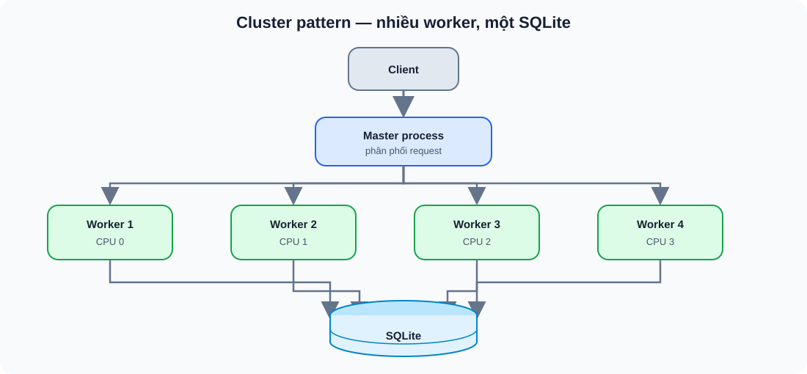
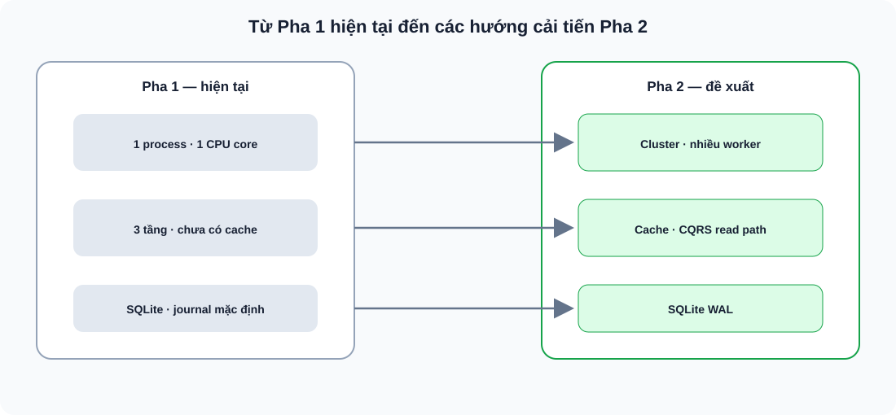

# CineRate — Tài liệu kiến trúc Pha 1

## 1. Tổng quan

CineRate là dịch vụ backend đánh giá phim, cung cấp REST API cho các chức năng: quản lý phim, chấm điểm, viết nhận xét và danh sách xem sau.

| | |
|---|---|
| **Ngôn ngữ** | JavaScript (Node.js 20+) |
| **Framework** | Express 4 |
| **ORM** | Prisma 6 |
| **Database** | SQLite |
| **Xác thực** | JWT (jsonwebtoken + bcryptjs) |
| **Tài liệu API** | OpenAPI 3.0 / Swagger UI |
| **Đóng gói** | Docker (Node 20 Alpine) |

## 2. Kiến trúc phân tầng

**Nguyên tắc chính:**

- **Tầng Presentation** — nhận HTTP request, xác thực JWT qua middleware, gọi service, trả JSON response. Phụ thuộc Express.
- **Tầng Business Logic** — chứa toàn bộ quy tắc nghiệp vụ. **Không import Express, Prisma hay bất kỳ thư viện DB/framework nào.** Chỉ dùng JavaScript thuần và utility nội bộ (`AppError`, `parseId`, `validateUserId`).
- **Tầng Data Access** — thực hiện truy vấn qua Prisma ORM. Mỗi entity có repository riêng, nhận `PrismaClient` qua constructor.

Các tầng được nối qua **dependency injection thủ công** tại [`container.js`](../src/container.js): tạo một `PrismaClient` duy nhất → inject vào repositories → inject repositories vào services → inject services vào controllers.

**Kiểm tra đầu vào:** hiện chưa có tầng schema validator riêng. Service kiểm tra dữ liệu nghiệp vụ; [`validate-id.js`](../src/utils/validate-id.js) kiểm tra ID.

## 3. Database

7 bảng, quan hệ cascade delete:

Ràng buộc unique `(userId, movieId)` trên bảng `ratings` và `watchlist` đảm bảo mỗi user chỉ có một rating và một mục watchlist cho mỗi phim.

## 4. API

18 API endpoint, xác thực qua middleware `authenticate` ở tầng route (không viết lặp trong controller). Benchmark đo thêm `/health`, nên có 19 route được đo:

| Method | Endpoint | Auth |
|--------|----------|:----:|
| POST | `/api/auth/register` | |
| POST | `/api/auth/login` | |
| GET | `/api/auth/profile` | 🔒 |
| PUT | `/api/auth/profile` | 🔒 |
| GET | `/api/movies` | |
| GET | `/api/movies/:id` | |
| POST | `/api/movies` | 🔒 |
| DELETE | `/api/movies/:id` | 🔒 |
| GET | `/api/genres` | |
| POST | `/api/movies/:id/ratings` | 🔒 |
| GET | `/api/movies/:id/ratings/summary` | |
| GET | `/api/ratings/me` | 🔒 |
| GET | `/api/movies/:id/reviews` | |
| POST | `/api/movies/:id/reviews` | 🔒 |
| DELETE | `/api/reviews/:id` | 🔒 |
| GET | `/api/watchlist` | 🔒 |
| POST | `/api/watchlist` | 🔒 |
| DELETE | `/api/watchlist/:movieId` | 🔒 |

Chi tiết request/response: [Swagger UI](http://localhost:3000/api-docs/) hoặc [`swagger.yaml`](./swagger.yaml).

## 5. Baseline Pha 1 — Kaggle CPU

**Môi trường:** Intel Xeon 2.20 GHz, 4 vCPU, 31 GB RAM, Node.js 20.19.0, SQLite.
**Cấu hình:** 10 client đồng thời × 10 giây / endpoint, 19 endpoint.

| Endpoint | RPS | Avg (ms) | p95 (ms) | p99 (ms) |
|----------|----:|--------:|---------:|---------:|
| `GET /health` | 2094 | 4.8 | 11.2 | 16.7 |
| `GET /api/genres` | 1467 | 6.8 | 12.5 | 15.5 |
| `GET /api/movies` | 1201 | 8.3 | 14.4 | 18.5 |
| `GET /api/movies/:id` | 1202 | 8.3 | 13.8 | 18.4 |
| `GET /api/movies/:id/ratings/summary` | 1030 | 9.7 | 15.2 | 19.7 |
| `GET /api/movies/:id/reviews` | 868 | 11.5 | 17.0 | 22.9 |
| `GET /api/ratings/me` | 570 | 17.5 | 21.7 | 26.8 |
| `GET /api/auth/profile` | 538 | 18.5 | 25.2 | 29.7 |
| `GET /api/watchlist` | 526 | 19.0 | 24.3 | 30.3 |
| `POST /api/movies/:id/ratings` | 76 | 129.3 | 222.7 | 1707.8 |
| `POST /api/movies` | 76 | 129.5 | 113.8 | 2325.9 |
| `POST /api/movies/:id/reviews` | 74 | 134.1 | 212.9 | 1830.6 |
| `PUT /api/auth/profile` | 64 | 154.6 | 148.3 | 1778.9 |
| `DELETE /api/movies/:id` | 32 | 151.4 | 583.1 | 1173.9 |
| `DELETE /api/watchlist/:movieId` | 32 | 147.7 | 547.3 | 2147.6 |
| `POST /api/watchlist` | 31 | 147.8 | 549.7 | 1854.0 |
| `DELETE /api/reviews/:id` | 30 | 163.0 | 748.6 | 1477.3 |
| `POST /api/auth/login` | 10 | 982.5 | 1585.3 | 1805.9 |
| `POST /api/auth/register` | 10 | 1016.1 | 1355.6 | 1649.0 |

**Tổng: 99,478 request / 193s ≈ 515 req/s.** 3 request timeout do SQLite single-writer lock dưới tải concurrent write.

### Nhận xét

- **GET endpoints** đạt 500–2000 RPS, latency trung bình < 20ms — SQLite đọc nhanh.
- **Write endpoints** chỉ 10–76 RPS, p99 lên tới 1–2s — bottleneck chính là SQLite chỉ cho phép 1 writer tại mỗi thời điểm.
- **Auth (register/login)** chậm nhất (~10 RPS) do bcrypt hash tốn CPU.
- Đây là số liệu baseline để so sánh trước/sau khi cải tiến ở Pha 2, trên cùng phần cứng và cấu hình.

## 6. Vấn đề kiến trúc và gợi ý cải tiến Pha 2

Phân tích dựa trên benchmark baseline và cấu trúc hiện tại. Chỉ liệt kê các vấn đề ở tầng **kiến trúc** — liên quan đến thuộc tính chất lượng (performance, scalability), mô hình xử lý và tổ chức hệ thống.

### 6.1 Mất cân bằng đọc–ghi (Read-Write Asymmetry)

Đây là vấn đề kiến trúc lớn nhất. Hệ thống hiện tại xử lý đọc và ghi qua cùng một đường — cùng process, cùng database connection, cùng tầng repository.

**Dẫn chứng từ benchmark:**

| | RPS | Avg latency |
|---|----:|--------:|
| GET endpoints | 526 – 2094 | 4 – 19 ms |
| Write endpoints | 10 – 76 | 129 – 1016 ms |

Chênh lệch **10–60 lần**. Nguyên nhân gốc: SQLite dùng file-level lock, chỉ cho phép **1 writer tại mỗi thời điểm** — toàn bộ write request xếp hàng tuần tự kể cả khi ghi vào bảng khác nhau. Ở mức 10 concurrent clients đã có 3 request timeout.

**Gợi ý kiến trúc:**

**CQRS (Command Query Responsibility Segregation):** Tách luồng đọc và ghi. Ví dụ: read request đi qua cache hoặc read replica, write request đi thẳng database. Kiến trúc phân tầng hiện tại đã tách rõ Service/Repository nên việc thêm CQRS ở tầng giữa không yêu cầu sửa lại toàn bộ.

**SQLite WAL mode:** Cho phép đọc đồng thời với ghi mà không cần thay database engine. Đây là cải tiến nhỏ nhất nhưng tác động lớn nhất đến write throughput.

### 6.2 Single-process — không sử dụng tài nguyên phần cứng

Node.js chạy **1 process = 1 CPU core**. Kaggle cung cấp 4 vCPU nhưng hệ thống chỉ dùng 1. Nghĩa là 75% tài nguyên CPU bị bỏ phí.

Đây là vấn đề về **deployment architecture** — cách hệ thống được triển khai để khai thác phần cứng.

**Gợi ý kiến trúc:**

**Cluster pattern:** Dùng Node.js Cluster module hoặc PM2 để chạy nhiều worker process. Mỗi worker là một bản sao đầy đủ của ứng dụng, chia tải ở tầng OS.

Lưu ý với SQLite: nhiều process ghi đồng thời sẽ **tăng lock contention**. Cluster chỉ hiệu quả khi kết hợp với WAL mode (6.1) hoặc khi workload chủ yếu là đọc.

### 6.3 Không có tầng cache trong kiến trúc

Kiến trúc hiện tại gồm 3 tầng: Controller → Service → Repository. Mỗi request dù đọc dữ liệu giống hệt nhau đều đi trọn vẹn 3 tầng rồi truy vấn DB.

Đây là vấn đề **thiếu tầng** trong kiến trúc. Với workload đọc nhiều ghi ít (đa số user xem phim, ít người tạo phim), một tầng cache sẽ thay đổi đáng kể hiệu năng.

**Gợi ý kiến trúc:**

Thêm **Cache Layer** giữa Service và Repository, giữ nguyên contract interface:

- Dữ liệu phù hợp cache: genres (gần như static), danh sách phim, rating summary.
- Cần chiến lược **cache invalidation** khi có write: write-through hoặc invalidate-on-write.

### Tổng hợp

Ba cải tiến này độc lập, có thể áp dụng riêng lẻ và đo tác động từng cái. Khi đánh giá Pha 2, chạy cùng load test script, cùng cấu hình (connections, duration, seed data), cùng Kaggle CPU — so sánh RPS, latency và số lỗi trước/sau.
