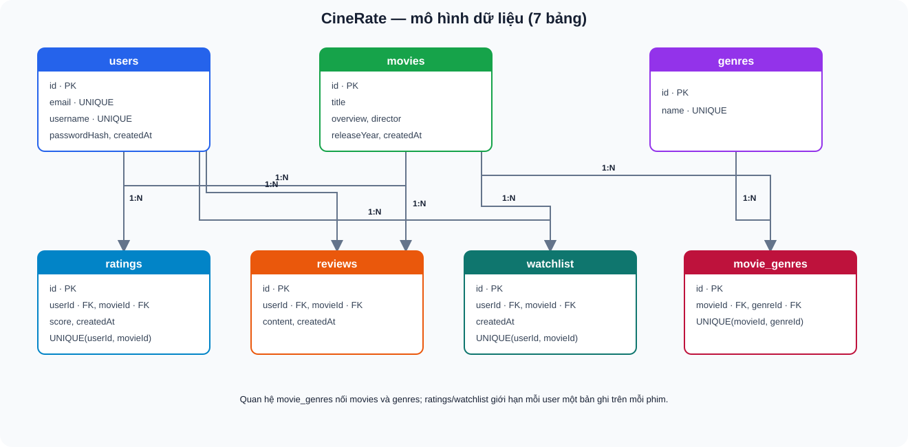
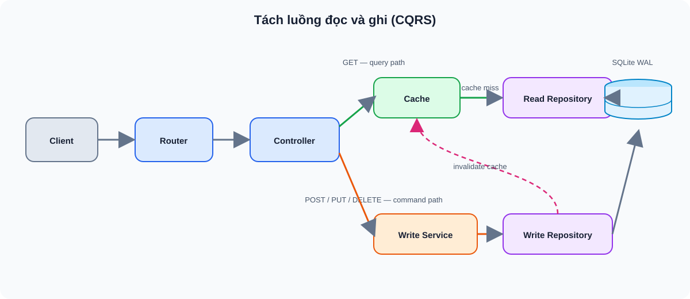
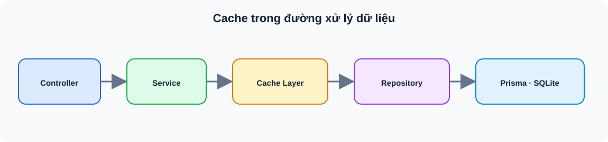
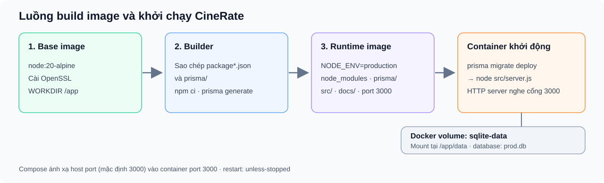

# CineRate — Tài liệu kiến trúc Pha 1

## 1. Tổng quan

CineRate là dịch vụ backend đánh giá phim, cung cấp REST API cho các chức năng: quản lý phim, chấm điểm, viết nhận xét và danh sách xem sau.

| | |
|---|---|
| **Ngôn ngữ** | JavaScript (Node.js 20.19+ cho bộ công cụ phát triển) |
| **Framework** | Express 4 |
| **ORM** | Prisma 6 |
| **Database** | SQLite |
| **Xác thực** | JWT (jsonwebtoken + bcryptjs) |
| **Tài liệu API** | OpenAPI 3.0 / Swagger UI |
| **Đóng gói** | Docker (Node 20 Alpine) |

## 2. Kiến trúc phân tầng


**Nguyên tắc chính:**

- **Tầng Presentation** — nhận HTTP request, xác thực JWT qua middleware, gọi service, trả JSON response. Phụ thuộc Express.
- **Tầng Business Logic** — chứa quy tắc nghiệp vụ, không import Express/Prisma và không truy vấn database trực tiếp; nhận repository qua constructor. AuthService hiện đọc cấu hình JWT từ `process.env` nên cấu hình môi trường vẫn gắn trực tiếp với service này.
- **Tầng Data Access** — thực hiện truy vấn qua Prisma ORM. Mỗi entity có repository riêng, nhận `PrismaClient` qua constructor.

Các tầng được nối qua **dependency injection thủ công** tại [`container.js`](../src/container.js): tạo một `PrismaClient` duy nhất → inject vào repositories → inject repositories vào services → inject services vào controllers.

**Kiểm tra đầu vào:** hiện chưa có tầng schema validator riêng. Service kiểm tra dữ liệu nghiệp vụ; [`validate-id.js`](../src/utils/validate-id.js) kiểm tra ID.

## 3. Database

7 bảng, quan hệ cascade delete:



Ràng buộc unique `(userId, movieId)` trên bảng `ratings` và `watchlist` đảm bảo mỗi user chỉ có một rating và một mục watchlist cho mỗi phim.

## 4. API

18 API endpoint, xác thực qua middleware `authenticate` ở tầng route (không viết lặp trong controller). Benchmark đo thêm `/health`, nên có 19 route được đo:

| Method | Endpoint | Auth |
|--------|----------|:----:|
| POST | `/api/auth/register` | |
| POST | `/api/auth/login` | |
| GET | `/api/auth/profile` | 🔒 |
| PUT | `/api/auth/profile` | 🔒 |
| GET | `/api/movies` | |
| GET | `/api/movies/:id` | |
| POST | `/api/movies` | 🔒 |
| DELETE | `/api/movies/:id` | 🔒 |
| GET | `/api/genres` | |
| POST | `/api/movies/:id/ratings` | 🔒 |
| GET | `/api/movies/:id/ratings/summary` | |
| GET | `/api/ratings/me` | 🔒 |
| GET | `/api/movies/:id/reviews` | |
| POST | `/api/movies/:id/reviews` | 🔒 |
| DELETE | `/api/reviews/:id` | 🔒 |
| GET | `/api/watchlist` | 🔒 |
| POST | `/api/watchlist` | 🔒 |
| DELETE | `/api/watchlist/:movieId` | 🔒 |

Chi tiết request/response: [Swagger UI](http://localhost:3000/api-docs/) hoặc [`swagger.yaml`](./swagger.yaml).

## 5. Baseline Pha 1 — Kaggle CPU

**Môi trường:** Intel Xeon 2.20 GHz, 4 vCPU, 31 GB RAM, Node.js 20.19.0, SQLite.
**Cấu hình:** 10 client đồng thời × 10 giây / endpoint, 19 endpoint.

| Endpoint | RPS | Avg (ms) | p95 (ms) | p99 (ms) |
|----------|----:|--------:|---------:|---------:|
| `GET /health` | 2094 | 4.8 | 11.2 | 16.7 |
| `GET /api/genres` | 1467 | 6.8 | 12.5 | 15.5 |
| `GET /api/movies` | 1201 | 8.3 | 14.4 | 18.5 |
| `GET /api/movies/:id` | 1202 | 8.3 | 13.8 | 18.4 |
| `GET /api/movies/:id/ratings/summary` | 1030 | 9.7 | 15.2 | 19.7 |
| `GET /api/movies/:id/reviews` | 868 | 11.5 | 17.0 | 22.9 |
| `GET /api/ratings/me` | 570 | 17.5 | 21.7 | 26.8 |
| `GET /api/auth/profile` | 538 | 18.5 | 25.2 | 29.7 |
| `GET /api/watchlist` | 526 | 19.0 | 24.3 | 30.3 |
| `POST /api/movies/:id/ratings` | 76 | 129.3 | 222.7 | 1707.8 |
| `POST /api/movies` | 76 | 129.5 | 113.8 | 2325.9 |
| `POST /api/movies/:id/reviews` | 74 | 134.1 | 212.9 | 1830.6 |
| `PUT /api/auth/profile` | 64 | 154.6 | 148.3 | 1778.9 |
| `DELETE /api/movies/:id` | 32 | 151.4 | 583.1 | 1173.9 |
| `DELETE /api/watchlist/:movieId` | 32 | 147.7 | 547.3 | 2147.6 |
| `POST /api/watchlist` | 31 | 147.8 | 549.7 | 1854.0 |
| `DELETE /api/reviews/:id` | 30 | 163.0 | 748.6 | 1477.3 |
| `POST /api/auth/login` | 10 | 982.5 | 1585.3 | 1805.9 |
| `POST /api/auth/register` | 10 | 1016.1 | 1355.6 | 1649.0 |

**Tổng: 99,478 request / 193s ≈ 515 req/s.** Có 3 request timeout dưới tải ghi đồng thời. Kết quả phù hợp với giả thuyết lock contention của SQLite, nhưng riêng benchmark này chưa xác nhận nguyên nhân duy nhất.

### Nhận xét

- **GET endpoints** đạt 500–2000 RPS, latency trung bình < 20ms — SQLite đọc nhanh.
- **Write endpoints** chỉ 10–76 RPS, p99 lên tới 1–2s — bottleneck chính là SQLite chỉ cho phép 1 writer tại mỗi thời điểm.
- **Auth (register/login)** chậm nhất (~10 RPS). Bcrypt là tác vụ CPU đáng khảo sát thêm; các số liệu này chưa tự chứng minh Event Loop bị chặn.
- Đây là số liệu baseline để so sánh trước/sau khi cải tiến ở Pha 2, trên cùng phần cứng và cấu hình.

## 6. Vấn đề kiến trúc và gợi ý cải tiến Pha 2

Phân tích dựa trên benchmark baseline và cấu trúc hiện tại.

### 6.1 Mất cân bằng đọc–ghi (Read-Write Asymmetry)

Đây là vấn đề kiến trúc lớn nhất. Hệ thống hiện tại xử lý đọc và ghi qua cùng một API process và cùng database SQLite, qua các tầng controller, service và repository.

**Dẫn chứng từ benchmark:**

| | RPS | Avg latency |
|---|----:|--------:|
| GET endpoints | 526 – 2094 | 4 – 19 ms |
| Write endpoints | 10 – 76 | 129 – 1016 ms |

Chênh lệch **10–60 lần**. SQLite chỉ cho phép **một writer tại mỗi thời điểm** trên cùng database. Các writer đồng thời có thể phải chờ hoặc gặp lỗi lock/busy tùy tình huống; không nên hiểu là mọi request ghi đều tự xếp hàng tuần tự. Ở mức 10 client đồng thời, benchmark ghi nhận 3 request timeout.

**Gợi ý kiến trúc:**

**CQRS (Command Query Responsibility Segregation):** Tách luồng đọc và ghi. Ví dụ: read request đi qua cache hoặc read replica, write request đi thẳng database. Kiến trúc phân tầng hiện tại đã tách rõ Service/Repository nên việc thêm CQRS ở tầng giữa không yêu cầu sửa lại toàn bộ.


**Bật chế độ SQLite WAL mode (Write-Ahead Logging):** cho phép vừa đọc vừa ghi đồng thời mà không chặn nhau.

### 6.2 Không có tầng cache trong kiến trúc

Kiến trúc hiện tại gồm 3 tầng: Controller → Service → Repository. Mỗi request dù đọc dữ liệu giống hệt nhau đều đi trọn vẹn 3 tầng rồi truy vấn DB.

Đây là vấn đề **thiếu tầng** trong kiến trúc. Với workload đọc nhiều ghi ít, cache có thể giảm các truy vấn lặp lại; mức cải thiện phụ thuộc dữ liệu, tỷ lệ cache hit và chiến lược invalidation, cần đo bằng benchmark.

**Gợi ý kiến trúc:**

Thêm **Cache Layer** giữa Service và Repository, giữ nguyên contract interface:



- Dữ liệu phù hợp cache: genres (gần như static), danh sách phim, rating summary.
- Cần chiến lược **cache invalidation** khi có write: write-through hoặc invalidate-on-write.

---

## 7. Kiến trúc Triển khai & Đóng gói (Deployment Architecture)

### 7.1 Docker image

Dockerfile có ba stage: base, builder và runtime.



1. **Base:** Dùng image `node:20-alpine` và cài `openssl`.
2. **Builder:** Sao chép `package*.json` và `prisma/`, chạy `npm ci` rồi `prisma generate`.
3. **Runtime:** Dùng lại base image, đặt `NODE_ENV=production`, sao chép toàn bộ `node_modules` từ builder cùng `prisma/`, `src/` và `docs/`. Tạo `/app/data` và khai báo cổng `3000`.

Builder chạy `npm ci` mà không loại dev dependencies; runtime nhận nguyên thư mục `node_modules` này. Prisma CLI được giữ lại để chạy migration lúc khởi động. Dockerfile không khai báo `USER`, nên container chạy bằng user mặc định của image nền.

### 7.2 Quản lý dữ liệu bền vững (Persistence) & Vòng đời Khởi chạy

- **Database:** Trong Compose, `DATABASE_URL` là `file:/app/data/prod.db`.
- **Volume:** Named volume `sqlite-data` được mount vào `/app/data`. File `prod.db` nằm trong volume này và được giữ lại khi container dừng hoặc được tạo lại; `docker compose down -v` xóa volume.
- **Khởi động:** Image chạy migration rồi mới khởi chạy HTTP server:
  ```bash
  sh -c "./node_modules/.bin/prisma migrate deploy && node src/server.js"
  ```
- Lệnh Compose khởi chạy service là `docker compose up --build -d`. Service có tên/container `cinerate-api`, ánh xạ cổng máy host sang cổng `3000` trong container và đặt restart policy `unless-stopped`.

### 7.3 Bảng biến môi trường triển khai
| Biến | Local / mặc định ứng dụng | Docker Compose | Hiện trạng |
|---|---|---|---|
| `PORT` | `3000` | Container dùng `3000`; host dùng `${PORT:-3000}` | Cổng HTTP của server |
| `NODE_ENV` | `development` | `production` | Chế độ chạy |
| `DATABASE_URL` | `file:./dev.db` trong `.env.example` | `file:/app/data/prod.db` | Database SQLite |
| `JWT_SECRET` | Mẫu `.env.example` có giá trị placeholder | Bắt buộc có giá trị khi Compose chạy | Khi chạy app trực tiếp mà thiếu biến, mã Auth dùng fallback `cinerate-secret-key` |
| `JWT_EXPIRES_IN` | `7d` | `7d` | Thời hạn JWT; AuthService đọc biến này |
| `BCRYPT_SALT_ROUNDS` | `10` trong mẫu môi trường | Compose truyền `10` | AuthService hiện truyền cố định `10` cho bcrypt; biến môi trường không thay đổi giá trị này |

---

## 8. Đặc tả API OpenAPI & Hướng dẫn Preview

Đặc tả 18 endpoints RESTful được duy trì theo **OpenAPI Specification 3.0.3** tại tệp YAML: [`docs/swagger.yaml`](./swagger.yaml). Mức độ chi tiết request/response hiện chưa đồng đều giữa các endpoint.

### 8.1 Các phương thức Preview đặc tả API
1. **Giao diện tương tác Swagger UI (Khuyên dùng):**
   - Khi máy chủ khởi chạy (`npm run dev`), truy cập đường dẫn: **`http://localhost:3000/api-docs/`**.
   - Hỗ trợ xem các endpoint và schema đã khai báo, cùng tính năng **"Try it out"** để gửi request và kiểm tra phản hồi trực tiếp.
2. **Preview trên IDE Visual Studio Code:**
   - Cài đặt extension: **OpenAPI (Swagger) Editor** hoặc **Swagger Viewer**.
   - Mở file [`docs/swagger.yaml`](./swagger.yaml), nhấn tổ hợp phím `Shift + Alt + E` để mở cửa sổ preview trực tiếp bên cạnh mã nguồn.
3. **Preview trực tuyến:**
   - Mở trình biên tập online [Swagger Editor](https://editor.swagger.io/) và import file [`swagger.yaml`](./swagger.yaml).

